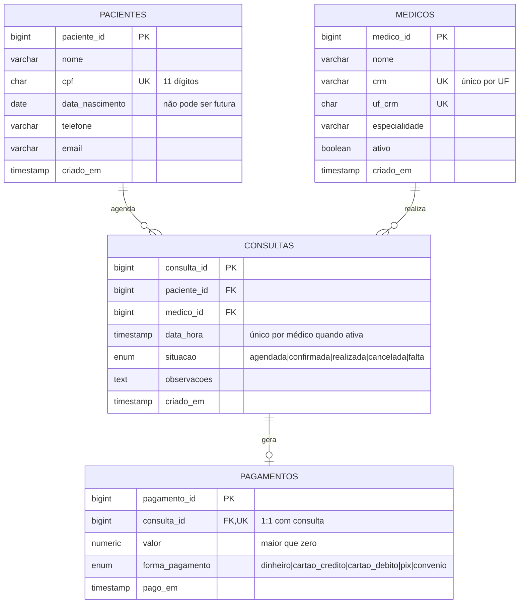

# Diagrama Entidade-Relacionamento — PostgreSQL

Parte relacional do modelo híbrido: agendamento e faturamento.



## Ligação com a parte NoSQL

A entidade **Registro Clínico** não aparece neste DER porque é persistida no MongoDB.
A ligação entre os dois bancos é feita por referência:

```
PostgreSQL: consultas.consulta_id  ──────►  MongoDB: registros_clinicos.consulta_id
```

O PostgreSQL permanece a fonte da verdade sobre pacientes, médicos e consultas. O
documento clínico guarda os identificadores, mas não pode ser validado por chave
estrangeira — essa consistência é responsabilidade da aplicação, e é o custo assumido
da arquitetura híbrida.

## Decisões de modelagem

| Decisão | Motivo |
| --- | --- |
| `situacao` como tipo `ENUM` e não `varchar` livre | Impede valores inválidos no próprio banco e documenta o ciclo de vida da consulta. |
| Pagamento em tabela separada, e não coluna em `consultas` | Uma consulta agendada ou cancelada não tem pagamento; manter colunas de valor nulas em `consultas` misturaria dois ciclos de vida distintos. |
| `valor` como `NUMERIC(10,2)` e não `FLOAT` | Valor financeiro exige precisão exata; ponto flutuante acumula erro de arredondamento. |
| Índice único **parcial** em (`medico_id`, `data_hora`) | O bloqueio de horário vale apenas para consultas ativas: um horário cancelado deve poder ser reaproveitado. |
| `ON DELETE RESTRICT` em `consultas` | Paciente com histórico não pode ser apagado — exigência de registro clínico e de auditoria. |
