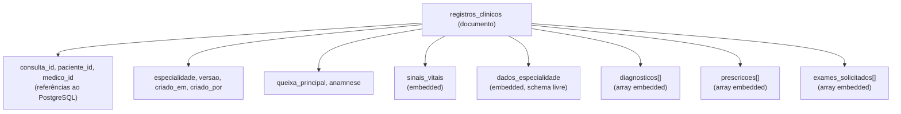

# Modelo de Documentos / Embedding — MongoDB

Parte NoSQL do modelo híbrido: o registro clínico (prontuário).

## Coleção `registros_clinicos`

Cada documento corresponde a uma versão do registro clínico de uma consulta. O
documento é autocontido: tudo que o médico precisa ver ao abrir o atendimento está em
uma única leitura, sem *joins*.



### Exemplo — Cardiologia

```js
{
  "_id": ObjectId("..."),
  "consulta_id": NumberLong(1042),
  "paciente_id": NumberLong(318),
  "medico_id": NumberLong(27),
  "especialidade": "Cardiologia",
  "versao": NumberInt(1),
  "criado_em": ISODate("2026-11-24T14:30:00Z"),
  "criado_por": "medico:27",
  "queixa_principal": "Dor no peito ao esforço há três semanas",
  "anamnese": "Paciente relata dor retroesternal em aperto durante caminhada...",
  "sinais_vitais": {
    "pressao_sistolica": 148,
    "pressao_diastolica": 92,
    "frequencia_cardiaca": 88,
    "saturacao_o2": 97,
    "peso_kg": 84.5
  },
  "dados_especialidade": {
    "ecg_ritmo": "sinusal",
    "ecg_laudo": "Sobrecarga de ventrículo esquerdo",
    "classificacao_nyha": "II",
    "risco_framingham": "intermediario"
  },
  "diagnosticos": [
    { "cid10": "I20.9", "descricao": "Angina pectoris não especificada", "tipo": "hipotese" }
  ],
  "prescricoes": [
    { "medicamento": "AAS", "dosagem": "100mg", "posologia": "1x ao dia", "duracao_dias": 90 }
  ],
  "exames_solicitados": [
    { "nome": "Teste ergométrico", "prioridade": "rotina" }
  ]
}
```

### Exemplo — Ortopedia (mesma coleção, `dados_especialidade` diferente)

```js
{
  "consulta_id": NumberLong(1043),
  "paciente_id": NumberLong(412),
  "medico_id": NumberLong(9),
  "especialidade": "Ortopedia",
  "versao": NumberInt(1),
  "criado_em": ISODate("2026-11-24T15:10:00Z"),
  "criado_por": "medico:9",
  "queixa_principal": "Dor no joelho direito após queda",
  "sinais_vitais": { "peso_kg": 71.2 },
  "dados_especialidade": {
    "lado": "direito",
    "amplitude_movimento_graus": 95,
    "testes_especiais": { "lachman": "positivo", "gaveta_anterior": "positivo" },
    "escala_dor_eva": 7
  },
  "diagnosticos": [
    { "cid10": "S83.5", "descricao": "Entorse com ruptura do ligamento cruzado", "tipo": "hipotese" }
  ],
  "exames_solicitados": [
    { "nome": "Ressonância magnética de joelho direito", "prioridade": "urgente" }
  ]
}
```

É exatamente essa diferença entre `dados_especialidade` que justifica o MongoDB: as
duas especialidades convivem na mesma coleção sem colunas nulas, sem tabelas de
atributos e sem alteração de esquema quando uma nova especialidade é incluída.

> Os identificadores aparecem como `NumberLong(...)` e a versão como `NumberInt(...)`
> porque no `mongosh` um literal numérico é gravado como `double`, e o validador da
> coleção exige `int`/`long` nesses campos. Os blocos acima usam a notação do shell do
> MongoDB (`ObjectId`, `ISODate`, `NumberLong`), e não JSON puro.

## O que foi embutido e o que foi referenciado

| Dado | Estratégia | Motivo |
| --- | --- | --- |
| `sinais_vitais` | **Embedding** | Pertence a um único atendimento, é lido sempre junto com ele e nunca consultado isoladamente. |
| `dados_especialidade` | **Embedding** com esquema livre | É o campo que varia por especialidade; é o motivo de o prontuário estar no MongoDB. |
| `diagnosticos`, `prescricoes`, `exames_solicitados` | **Embedding** em array | Cardinalidade baixa e limitada (poucos itens por consulta), sem crescimento ilimitado, sempre lidos com o documento. |
| Dados do paciente e do médico | **Referência** (`paciente_id`, `medico_id`) | São dados mutáveis e compartilhados por muitas consultas; duplicá-los em cada documento geraria inconsistência a cada atualização de cadastro. |
| Consulta (data, situação, pagamento) | **Referência** (`consulta_id`) | Vive no PostgreSQL, onde as garantias transacionais são necessárias. |

## Versionamento (RNF03)

Registro clínico não é atualizado no lugar. Uma correção grava um **novo documento**
com o mesmo `consulta_id` e `versao` incrementada. A versão vigente é a de maior
`versao`, e o histórico completo fica preservado para auditoria.

## Índices previstos

| Índice | Finalidade |
| --- | --- |
| `{ consulta_id: 1, versao: -1 }` | Recuperar a versão vigente do registro de uma consulta. |
| `{ paciente_id: 1, criado_em: -1 }` | Montar o histórico clínico do paciente em ordem cronológica (RF07, RNF02). |
| `{ especialidade: 1 }` | Relatórios e consultas agregadas por especialidade. |
